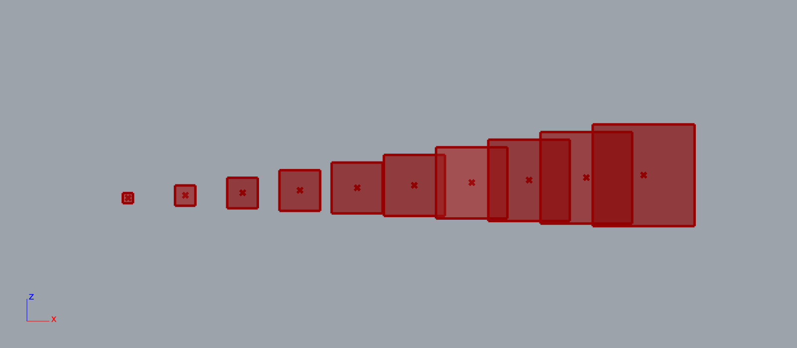

# 001 · 渐变立方体阵列（半径逐个 ×2）

**状态：已验证** ｜ 形态：GH 定义 ｜ 2026-11-23

---

## 1. 想法（原话）

> 「在 Reno 界面中建 10 个立方体，每个立方体的半径做个乘 2」

**先修一个词**：立方体没有"半径"。按最常用的对应关系取**内切球半径 = 半边长**，即 `r = 边长 / 2`。
所以"半径 ×2"等价于"边长 ×2"，第 i 个的半径 = `i × 基准 × 2`。

> 记录原话的意义：三天后回看，能确认"当时我到底想要什么"，而不是被后来实现出来的东西带跑。

---

## 2. 原理

**为什么手动建 10 个盒子达不到这个目的**：

在 Rhino 里 `Box` 十次 → 文档里有 10 个 Brep（结果几何）。想改成 20 个、或者倍率从 2 改成 2.5，只能重做。
而且这 10 个盒子"是怎么来的"——第 3 个为什么是 12 而不是 11——**已经永久丢失**。

**为什么 GH 能做到**：GH 画布存的是 `参数 → 组件 → 连线`，即**构造过程**。
改一个滑块，GH 按拓扑顺序把下游全部重算，10 个盒子同时变。

**一个省组件的几何技巧**：边长 = 2 × 半径，所以把盒子中心抬到 `Z = 半径`，底面正好落在 `z = 0`。
这一条数值关系省掉了 `size/2` 那一步除法和一个组件——构造序列里最划算的一类优化。

**GH 与"建模历史"的关系**（对应 `skill/references/feature-recognition.md` 第 8、9 节）：
GH 给你历史感，但那份历史是**你亲手写下的**。面对别人建的/导入的哑实体，GH 没有"这条边原本是哪次倒角"的信息，
那是 FeatureWorks 的逆向识别要解决的问题，两者方向相反、不能互相替代。

---

## 3. 构造序列

| # | 组件 | 输入 | 输出 | 输出长度 |
|---|---|---|---|---|
| ① | `Series` | Start=起始序号, Step=1, Count=N | 序号 1…N | List(N) |
| ② | `Multiplication` | 序号 × 基准半径 | 基准半径序列 | List(N) |
| ③ | `Multiplication` | ②× 倍率 | **半径 r** | List(N) |
| ④ | `Multiplication` | ③ × 2 | 边长 size | List(N) |
| ⑤ | `Multiplication` | 序号 × 间距 | X 位置 | List(N) |
| ⑥ | `Construct Point` | X=⑤, Y=Y偏移, Z=**③（半径）** | 点 | List(N) |
| ⑦ | `XY Plane` | 点 | 平面 | List(N) |
| ⑧ | `Center Box` | 平面 / size / size / size | **盒子** | List(N) |

**数据结构说明**：全部是单分支 `List(N)`，`{0}` 一条到底。
② ③ ④ ⑤ 里那个"单值"输入（基准、倍率、间距）是**广播**到 N 个；⑧ 的四个 `List(N)` 是**一一对应**。
这就是它一次能出 10 个盒子的原因——不是循环，是匹配规则。

---

## 4. 自由度（6 个手柄）

| 参数 | 含义 | 范围 | 默认 |
|---|---|---|---|
| `N` | 个数 | 1–30 | 10 |
| `起始序号` | 序列起点（决定最小尺寸） | 0–10 | 1 |
| `基准半径` | 第 1 个的半径基准 | 0.1–5 | 1.0 |
| `半径倍率` | 每个半径乘多少 | 0.5–6 | 2.0 |
| `间距` | 相邻中心距 | 10–150 | 45 |
| `Y偏移` | 整排位置 | 0–300 | 0 |

> 交付原则：**留够能拖的手柄**。只能看不能动的结果，对设计没有价值。

---

## 5. 为什么选 GH 而不是 C# 插件

| 判断 | 结论 |
|---|---|
| 需要多个自由度实时试 | ✅ GH 天生就是干这个的 |
| 是探索性的一次性设计 | ✅ 不值得走编译/打包/安装流程 |
| 需要给"不会 GH 的人"一键完成 | ❌ 没有这个要求 |
| 需要精确 B-rep 手术 | ❌ 这里只是造盒子 |

选 GH。如果以后要"一键生成 + 面板勾选"，再考虑包成插件——那时才是 C# 的场合。

---

## 6. 证据（2026-11-23 实测）

**画布**：14 个对象 / 18 条连线 / `solved=true` / `reported=0`

**数据读回**：

| 输出 | 期望 | 实测 |
|---|---|---|
| Series | 1…10 | `1, 2` …（10 items）✓ |
| 半径 | 2, 4, …, 20 | `2, 4` …（10）✓ |
| 边长 | 4, 8, …, 40 | `4, 8` …（10）✓ |
| X 位置 | 45, 90, …, 450 | `45, 90` …（10）✓ |
| 点 | Z = 半径 | `{45,0,2}`, `{90,0,4}` ✓ |
| Center Box | 10 个有效盒 | 10 items，sample 全为 `Box`，无 `Singular Box` ✓ |
| 视口 | 10 个递增、底面齐平 | 平行投影正视图确认 ✓ |
| 文档对象 | 0（GH 不落地） | `doc.Objects.Count = 0` ✓ |

---

## 7. 两个坑（真实发生）

### 坑 1：`Series` 的 `Start` 默认是 0

第一次搭漏接了 `Start`，序列成了 `0…9`，于是第 1 个盒子边长 = 0 →
`Center Box` 输出 **`Singular Box`（退化盒）**。

**但求解器仍报 `solved=true`、0 报错、0 warning。**
GH 不认为"尺寸为 0 的盒子"是错误。

> 教训：`solved=true` ≠ 几何有效。必须读数据 + 看几何。
> 如果只看求解状态就交付，就是又一次"技术上成功、结果错了"。

### 坑 2：`place_slider` 的 schema 要求 object

单独调 `g1_place_slider` 时 `min/value/max` 必须是 JSON object 或 null；
而批量接口 `g1_apply_graph` 的 `sliders[]` 传数字却能过。

**处置**：不跟 schema 绕，改用已验证的批量路径重建整图——代价是重建，好处是路径确定。

---

## 8. 可改进（下次一起做）

- [ ] X 从 0 开始（现在第一个在 x=45）→ 改成 `(序号-1) × 间距`
- [ ] 间距改成**累加**（`Mass Addition` 的 Partial Results 输出），让相邻面刚好贴合
- [ ] Bake 成实体，方便后续布尔 / 倒角
- [ ] 存 `.gh` 文件 + Cluster 打包，给团队复用
- [ ] 往"有趣设计"走：加逐级旋转、材质渐变、按曲面法线取向（这时才开始需要 DataTree 的分支）
- [ ] 用 `g2_*` 在 GH2 画布上重做一版，对比两代 API 差异

---

## 9. 复盘

**做对的**：先核实组件签名（`describe_component`）再连线，18 条线一次全通，没有瞎猜。
**翻车的**：只看了 `solved=true` 就以为成了，读回数据才发现第一个盒子是退化盒。
**下次更快的方式**：搭完立刻读 `data.items` + 抽样 2 个值，比截图更快发现数量/数值错误。
